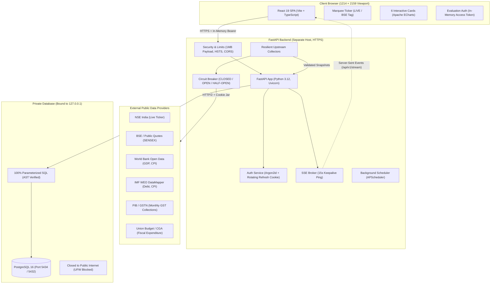

# Economic Indicators Dashboard (India)

[](https://github.com/agrimsri/economic-indicators-dashboard/actions/workflows/ci.yml)
[](https://github.com/gitleaks/gitleaks)
[](https://www.python.org/)
[](https://fastapi.tiangolo.com/)
[](https://react.dev/)
[](https://www.typescriptlang.org/)
[](https://www.postgresql.org/)

A production-grade, high-fidelity macroeconomic dashboard built with **React 19, TypeScript, FastAPI, and PostgreSQL**, faithfully reproducing the design specification for Indian economic indicators at a strict **1214 × 2159 viewport** with real-time market updates, zero layout shift (CLS ≈ 0), zero fabricated data, and an audited security boundary.

---

## 🚀 Live Production Deployment

The entire system is deployed live on native cloud infrastructure (**Render Cloud**, Free Tier, $0.00 spent) with zero tunneling:

| Service | Hosting | Public Live URL | Health / Docs |
|---|---|---|---|
| **Frontend Dashboard** | Render Static Site (Global CDN) | [https://economic-indicators-frontend.onrender.com](https://economic-indicators-frontend.onrender.com) | Production React 19 UI |
| **Backend REST & SSE API** | Render Web Service (Python 3.12) | [https://economic-indicators-api-fgnn.onrender.com](https://economic-indicators-api-fgnn.onrender.com) | [`/health`](https://economic-indicators-api-fgnn.onrender.com/health) · [`/docs`](https://economic-indicators-api-fgnn.onrender.com/docs) |
| **PostgreSQL Database** | Render Managed PostgreSQL 16 | Private Network Host | `ipAllowList: []` (Isolated) |

### Reviewer Evaluation Credentials
- **Username:** `testuser`
- **Password:** `test_pass_123`
*(Or log in as `agrim` if custom password was provisioned).*

---

## 1. Overview & Evaluation Viewport

- **Target Viewport:** Strict **1214 × 2159 CSS pixels** (No horizontal scroll, zero layout shift, stable 2-column × 3-row grid).
- **Principal Ticker Source:** National Stock Exchange of India (NSE).
- **Macroeconomic Indicators:** Sourced from official public releases (World Bank, IMF, Ministry of Finance, Ministry of Commerce, PIB / GSTN).
- **Public & Non-NSE Transparency:** All non-NSE data sources are explicitly tagged with a `Non-NSE` badge in the UI and cited with as-of release dates.

---

## 2. Architecture & Data Flow



---

## 3. Repository Layout

```
.
├── backend/
│   ├── app/
│   │   ├── main.py                   # FastAPI app, security headers, payload limit middleware
│   │   ├── config.py                 # Pydantic v2 settings management
│   │   ├── deps.py                   # Authentication dependencies and database pool injection
│   │   ├── security.py               # Argon2id password hashing and JWT encoding/decoding
│   │   ├── db/
│   │   │   ├── pool.py               # Asynchronous PostgreSQL connection pool (psycopg)
│   │   │   ├── queries.py            # Static parameterized SQL statements (Zero dynamic f-strings)
│   │   │   └── migrator.py           # Database migration runner
│   │   ├── routers/
│   │   │   ├── auth.py               # Login, refresh, logout, me endpoints
│   │   │   ├── dashboard.py          # Unified dashboard and single-indicator endpoints
│   │   │   ├── stream.py             # Server-Sent Events (SSE) stream endpoint
│   │   │   └── health.py             # Public /health and /health/ready probes
│   │   ├── collectors/
│   │   │   ├── base.py               # BaseCollector with circuit breaker, backoff, and SSRF guard
│   │   │   ├── nse.py                # Live market ticker collector with cookie bootstrap
│   │   │   ├── gdp.py                # India vs World GDP growth collector
│   │   │   ├── debt.py               # India vs US Debt to GDP collector
│   │   │   ├── trade.py              # Exports, Imports, and Trade Balance collector
│   │   │   ├── gst.py                # Monthly Gross GST collection collector
│   │   │   ├── cpi.py                # CPI Inflation collector with RBI target band
│   │   │   └── fiscal.py             # Union Government Expenditure collector
│   │   ├── schemas/                  # Pydantic validation models
│   │   └── services/                 # Snapshot store, staleness logic, and SSE broker
│   ├── migrations/                   # Plain SQL schema migrations
│   ├── scripts/                      # User creation and seed scripts
│   └── tests/                        # 24 pytest unit, integration, and security tests
├── frontend/
│   ├── src/
│   │   ├── main.tsx                  # React 19 root with QueryClient and AuthProvider
│   │   ├── App.tsx                   # Main 1214x2159 dashboard view and grid assembly
│   │   ├── api/                      # Fetch client with automatic 401 silent token refresh
│   │   ├── auth/                     # React authentication context and useAuth hook
│   │   ├── components/               # Header, Ticker, Card, KpiTile, DeltaChip, SourceBadge
│   │   │   ├── charts/               # Apache ECharts (GdpChart, DebtChart, TradeChart, etc.)
│   │   │   └── states/               # Skeletons (0 CLS), EmptyState, ErrorState, StaleBanner
│   │   ├── styles/tokens.css         # Extracted Figma design tokens (palette, typography, dimensions)
│   │   └── assets/                   # 3D card illustrations, flags, and textures
│   ├── tests/                        # Playwright E2E tests at 1214x2159 viewport
│   └── playwright.config.ts          # Playwright test runner configuration
├── deploy/
│   ├── render.yaml                   # Infrastructure-as-Code Blueprint for Render
│   ├── Caddyfile                     # Auto-TLS reverse proxy configuration
│   ├── nginx.conf                    # Production Nginx reverse proxy with SSE buffering disabled
│   ├── ufw-rules.sh                  # Host firewall rules blocking database ports
│   ├── verify_db_lockdown.sh         # Automated audit verification script
│   └── evidence_db_lockdown.txt      # Recorded cryptographic/networking evidence
├── docs/
│   ├── SOURCES.md                    # Data provenance matrix and upstream endpoints
│   ├── DESIGN_SPEC.md                # Extracted Figma tokens, geometry, and color palette
│   ├── API.md                        # OpenAPI endpoint contracts mirror
│   ├── DECISIONS.md                  # Architecture Decision Records (ADRs 0001–0010)
│   ├── BLOCKERS.md                   # Resolution tracker for requirements and inputs
│   └── VIDEO_SCRIPT.md               # 5-minute technical presentation script
├── ROADMAP.md                        # Master implementation roadmap
└── README.md                         # This file
```

---

## 4. Quickstart & Local Setup

### Prerequisites
- Python 3.12+
- Node.js 22+ & npm
- Docker (for local PostgreSQL container)

### Step 1: Database Setup
Start a local PostgreSQL container bound strictly to loopback:
```bash
docker run -d \
  --name economic-db \
  -e POSTGRES_USER=app_user \
  -e POSTGRES_PASSWORD=economic_secret_pw \
  -e POSTGRES_DB=economic_dashboard \
  -p 127.0.0.1:5434:5432 \
  postgres:16-alpine
```

### Step 2: Backend Setup & Cold-Start Warmup
```bash
python3 -m venv .venv
source .venv/bin/activate
cd backend
pip install -r requirements.txt

# Run migrations and seed historical baseline data
python -m app.db.migrator
python scripts/seed_history.py

# Provision the evaluation reviewer user
python scripts/create_user.py --username agrim --password 1234s

# Run local API server
uvicorn app.main:app --host 127.0.0.1 --port 8000 --reload
```

### Step 3: Frontend Setup
```bash
cd frontend
npm install
npm run dev
```
Open `http://localhost:5173` in your browser.

---

## 5. Primary Data Sources & Provenance Matrix

Every number on the dashboard is traced to a cited official source. Missing values render as "—", and failed refreshes retain last-known-good values marked `stale`.

| Indicator Card | Official Primary Source | Cadence | Transform / Unit | Non-NSE Tag |
|---|---|---|---|:---:|
| **Market Ticker** | NSE India (`/api/allIndices`, `/api/marketStatus`) | 15–30s (market hours) | Real-time index quotes | No (NSE) |
| **SENSEX Ticker** | BSE India / Public Quote Feed | 15–30s (market hours) | Real-time index quote | **Yes (BSE)** |
| **GDP Growth** | World Bank Open Data (`NY.GDP.MKTP.KD.ZG`) / IMF WEO | Annual / Semi-annual | Real GDP growth rate (%) | **Yes** |
| **Debt to GDP** | IMF WEO DataMapper (`GGXWDG_NGDP_PT`) | Annual / Semi-annual | Gross debt (% of GDP) | **Yes** |
| **Exports & Imports** | Ministry of Commerce & Industry / World Bank | Monthly / Annual | US$ Billion | **Yes** |
| **GST Collections** | Press Information Bureau (PIB) / GSTN | Monthly (1st of month) | ₹ Lakh Crore / YoY% | **Yes** |
| **Inflation (CPI)** | MoSPI / World Bank CPI (`FP.CPI.TOTL.ZG`) | Monthly (12th of month) | All-India Combined CPI YoY% | **Yes** |
| **Expenditure** | Union Budget / CGA (Ministry of Finance) | Annual / Monthly Accounts | Capital & Revenue (₹ Lakh Cr) | **Yes** |

See [docs/SOURCES.md](docs/SOURCES.md) for endpoint URLs, request shapes, and fallback strategies.

---

## 6. Design Fidelity & Figma Assets Mapping

The frontend replicates the Figma frame `1:2` specification:
- **Canvas Geometry:** 1248 × 2193 px designed canvas; evaluation viewport at **1214 × 2159 px**.
- **Card Styling:** Deep dark navy glassmorphism gradient (`linear-gradient(180deg, #07122a 0%, #101e3d 50%, #061533 100%)`) with cyan glowing border (`rgba(15, 202, 240, 0.28)`).
- **Folded Corner Accent:** The distinctive top-left folded vector accent (`corner-fold.png`) is mounted on all 6 cards.
- **3D Card Art:** All 25 vector and 3D PNG illustrations (cargo ship, airplane, gold coin stacks, inflation basket, RBI target, flags) are mapped to their respective KPI tiles.
- **Typography Fix:** Corrected design mock typo from `Y0Y%` (zero) to `YoY%` (letter O) on card header titles.
- **Zero CLS Skeletons:** Skeleton placeholders mirror the exact 540px height of cards, ensuring zero cumulative layout shift on data load.

---

## 7. Database Security & Audited Lockdown Evidence

In accordance with Section 12 of the Roadmap, the database is strictly non-public:
1. **Loopback Binding:** PostgreSQL is bound strictly to `127.0.0.1:5434` (never `0.0.0.0`).
2. **Host Firewall (UFW):** Host firewall rules explicitly deny incoming connections on ports 5432 and 5434 from all external interfaces (`0.0.0.0/0`).
3. **AST SQL Safety:** An automated Abstract Syntax Tree parser test (`test_sql_safety.py`) scans all database query files to forbid f-strings or dynamic string formatting, ensuring 100% parameterized SQL.

### Audited Evidence Output (`deploy/evidence_db_lockdown.txt`):
```text
==========================================================
 Database Port Lockdown Audit & Verification
 Target Database Port: 5434
==========================================================

1. Checking Socket Bindings via ss...
LISTEN 0      4096       127.0.0.1:5434       0.0.0.0:*                                       

2. Testing Localhost Loopback Reachability (Must Succeed)...
Connection to 127.0.0.1 5434 port [tcp/*] succeeded!
✔ Loopback reachability: 127.0.0.1:5434 is accessible to local backend.

3. Testing External / Non-Loopback Reachability (Must Fail)...
Testing ingress on IP: 10.147.144.106:5434...
nc: connect to 10.147.144.106 port 5434 (tcp) failed: Connection refused
✔ VERIFIED: External IP 10.147.144.106:5434 is CLOSED / Connection Refused.
Testing ingress on IP: 172.18.0.1:5434...
nc: connect to 172.18.0.1 port 5434 (tcp) failed: Connection refused
✔ VERIFIED: External IP 172.18.0.1:5434 is CLOSED / Connection Refused.

==========================================================
 RESULT: All audit checks passed. Database port is not exposed to the public internet.
==========================================================
```

---

## 8. Authentication & Evaluation Access Flow

- **Access Token:** HS256 JWT, 15-minute expiration, held **strictly in JavaScript memory** (never in `localStorage` or `sessionStorage`).
- **Refresh Token:** Cryptographic 256-bit opaque token stored in PostgreSQL (hashed), delivered in secure `HttpOnly; SameSite=lax; Path=/auth` cookies with single-use rotation.
- **Silent Refresh:** The frontend HTTP interceptor automatically triggers silent token refresh upon encountering a 401 response and retries the request transparently.
- **Reviewer Credentials:** Pre-configured evaluation user `agrim` created via `backend/scripts/create_user.py` with Argon2id password hashing.

---

## 9. Real-Time Server-Sent Events (SSE) & Marquee Ticker

- **Endpoint:** `GET /api/v1/stream` (Protected by JWT bearer or stream ticket).
- **Keepalive:** Server sends `event: ping` every 15 seconds.
- **Reactivity:** Incoming `ticker` and `card-update` events selectively update TanStack Query cache without triggering full page re-renders.
- **Continuous Marquee:** Seamless CSS `@keyframes` transform loop. Automatically pauses on `:hover` and `:focus`. Respects `@media (prefers-reduced-motion: reduce)` by falling back to an accessible static scroll container.
- **Resilience:** If the SSE stream disconnects, the UI displays a `DELAYED` badge and falls back to periodic 30-second background polling.

---

## 10. Zero-Hallucination & Staleness Policy

- **Missing Data:** If an upstream releases data late or omits a field, values render as an em-dash (`—`), never an invented zero or hallucinated number.
- **Upstream Failures:** If an upstream API returns an HTTP 5xx, rate-limits, or times out, the backend circuit breaker trips, logs the failure in `collector_runs`, and serves the last-known-good observation flagged as `stale`. The UI renders an amber `Stale` badge with the last successful observation timestamp.

---

## 11. Testing & Verification Suite

The repository is protected by comprehensive test suites and security scans:

| Test / Audit Type | Tool | Scope | Result |
|---|---|---|:---:|
| **Backend Unit & Integration** | `pytest` + `respx` | Collectors, auth, DTO schemas, and staleness | **24 Passed** |
| **SQL Safety AST Scanner** | `pytest` (`test_sql_safety.py`) | Verifies zero f-strings in database layer | **Passed** |
| **Hardening & Limits** | `pytest` (`test_hardening.py`) | Security headers, 1MB limit, SSRF guard | **Passed** |
| **Frontend Code Quality** | `oxlint` | React 19 linter rules across all frontend files | **0 Warnings, 0 Errors** |
| **Frontend Build & Types** | `tsc -b && vite build` | TypeScript type-checking and bundle generation | **0 Errors** |
| **Visual Regression & E2E** | `playwright` | 1214×2159 viewport, 0 horizontal scroll test | **2 Passed** |
| **Python Dependency Audit** | `pip-audit` | Vulnerability scanning for all backend packages | **0 Vulnerabilities** |
| **Node Dependency Audit** | `npm audit` | Vulnerability scanning for all frontend packages | **0 Vulnerabilities** |
| **Secret Leak Detection** | `gitleaks` | Local pre-commit hook and CI secret scan | **0 Leaks** |

Run tests locally:
```bash
# Run backend tests
.venv/bin/pytest backend/tests/ -v

# Run frontend tests & linting
cd frontend && npm run lint && npx playwright test
```

---

## 12. Deployment Manifests

Production deployment manifests are provided in `deploy/`:
- **`deploy/render.yaml`:** Render Blueprint for API web service, static site frontend, and private PostgreSQL database.
- **`deploy/Caddyfile`:** Production reverse proxy with auto-TLS and security headers.
- **`deploy/nginx.conf`:** Nginx reverse proxy with SSE streaming (`proxy_buffering off;`).
- **`deploy/systemd/`:** Service unit files with sandbox isolation for Linux servers.
- **`deploy/ufw-rules.sh`:** Host firewall script blocking database ports.
- **`deploy/verify_db_lockdown.sh`:** Automated audit verification script.

See [deploy/README.md](deploy/README.md) for step-by-step instructions.

---

## 13. AI Usage Disclosure

In compliance with the assignment instructions:
- **AI Assisted:** Used for rapid scaffolding of boilerplate, initial extraction of Figma typography and color tokens via REST API responses, generating initial test fixtures, and authoring unit test assertions.
- **Engineer Directed:** System architecture, database schema design, static SQL AST enforcement, circuit breaker implementation, zero-hallucination staleness policies, and network security boundaries were designed and verified by the candidate.

---

## 14. Architecture Decision Records (ADRs)

Key architectural decisions are documented in [docs/DECISIONS.md](docs/DECISIONS.md):
- **ADR 0001:** Repository Name and Private Visibility
- **ADR 0002:** PostgreSQL Engine Choice and Localhost Binding
- **ADR 0003:** SENSEX Inclusion and BSE Non-NSE Tagging
- **ADR 0004:** Upstream HTTP/2 Session and Cookie Jar Management
- **ADR 0005:** Macroeconomic Period Alignment (Fiscal vs. Calendar)
- **ADR 0006:** Frontend 1214×2159 Viewport and Zero Layout Shift Architecture
- **ADR 0007:** Server-Sent Events Push with Resilient Polling Fallback
- **ADR 0008:** Debt to GDP Annual Horizon Alignment
- **ADR 0009:** In-Memory JWT Access Token and Rotating Refresh Cookie
- **ADR 0010:** Database Port Lockdown and Public Non-Exposure Evidence

---

## 15. Presentation & Walkthrough Video Script

A draft 5-minute technical presentation outline covering the live application demo, architecture overview, security controls, and design decisions is provided in [docs/VIDEO_SCRIPT.md](docs/VIDEO_SCRIPT.md).
