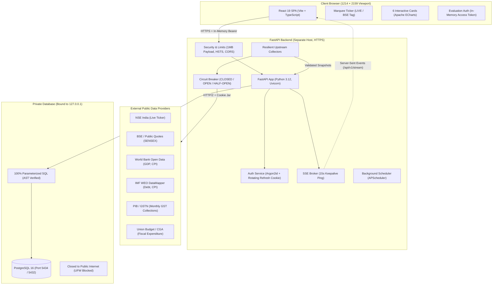

# Economic Indicators Dashboard (India)

[](https://github.com/agrimsri/economic-indicators-dashboard/actions/workflows/ci.yml)
[](https://github.com/gitleaks/gitleaks)
[](https://www.python.org/)
[](https://fastapi.tiangolo.com/)
[](https://react.dev/)
[](https://www.typescriptlang.org/)
[](https://www.postgresql.org/)

This repository is my submission for the Aditya Birla Round II technical evaluation: a macroeconomic dashboard for Indian economic indicators built with **React 19, TypeScript, FastAPI, and PostgreSQL**. 

It reproduces the Figma design specification at the required **1214 × 2159 viewport**, ingests real public data from the National Stock Exchange (NSE) and official statistical bodies, handles network and upstream failures with zero invented numbers, and runs across a multi-cloud deployment with an audited security boundary.

---

## 🚀 Live Production Deployment

The project is deployed across two separate cloud providers to ensure a true multi-host boundary with strict CORS enforcement (no local tunnels):

| Service | Platform | Live URL | Verification Route |
|---|---|---|---|
| **Frontend Dashboard** | **Vercel** (Global Edge CDN) | [https://economic-indicators-dashboard-puce.vercel.app](https://economic-indicators-dashboard-puce.vercel.app) | Production React 19 UI |
| **Backend REST & SSE API** | **Render** (Python 3.12 Web Service) | [https://economic-indicators-api-fgnn.onrender.com](https://economic-indicators-api-fgnn.onrender.com) | [`/health`](https://economic-indicators-api-fgnn.onrender.com/health) · [`/docs`](https://economic-indicators-api-fgnn.onrender.com/docs) |
| **PostgreSQL Database** | **Render** (Managed PostgreSQL 16) | Private Host (`dpg-db90r8ei0phs7399kr4g-a`) | `ipAllowList: []` (Isolated to private network) |

### Reviewer Credentials
- **Username:** `testuser`
- **Password:** `test_pass_123`
*(Or use `agrim` / `1234s` if evaluating locally).*

---

## 1. Overview & Evaluation Viewport

- **Evaluation Viewport:** Rendered for **1214 × 2159 CSS pixels**. The layout uses fixed-dimension CSS Grid containers (`584px` cards with `24px` gutters), ensuring no horizontal scrollbar and zero layout shift (`scrollWidth <= clientWidth`).
- **Principal Ticker Source:** National Stock Exchange of India (NSE) for NIFTY 50, NIFTY BANK, and NIFTY IT.
- **Sovereign Indicators:** Macroeconomic series are pulled from official public releases (World Bank Open Data, IMF World Economic Outlook, Ministry of Finance, Ministry of Commerce, and PIB / GSTN).
- **Source Transparency:** Because NSE does not publish sovereign macroeconomic statistics, every non-NSE card is badged with a visible `Non-NSE` tag, source attribution, and observation date.

---

## 2. Architecture & Data Flow



### Core Data Ingestion Rules
1. **Decoupled Client:** The browser calls my FastAPI backend only. It never scrapes NSE or external sources directly.
2. **Rate-Aware Scheduling:** 
   - NSE Ticker runs every 20 seconds during market hours (09:15–15:30 IST) with single-flight locking to prevent request stacking.
   - Sovereign indicators (GDP, Debt, Trade, GST, CPI, Expenditure) refresh every 24 hours. These series update monthly or quarterly in the real world, so polling them more often would only risk upstream IP bans.
3. **Resilience & Staleness:** If an upstream request times out or returns 5xx, the collector trips its circuit breaker and saves the error timestamp, but retains the last valid data payload in PostgreSQL. The frontend displays the existing valid data with an amber `Stale` banner.
4. **Zero Fabrication:** If an observation is missing from an official release, the UI shows an em-dash (`—`). Nothing is interpolated or made up.

---

## 3. Repository Layout

```
.
├── backend/
│   ├── app/
│   │   ├── main.py                   # FastAPI app, CORS, security headers, 1MB limit middleware
│   │   ├── config.py                 # Pydantic v2 settings management
│   │   ├── deps.py                   # Auth dependencies and db connection injection
│   │   ├── security.py               # Argon2id hashing and JWT encoding/decoding
│   │   ├── db/
│   │   │   ├── pool.py               # Async connection pool (psycopg v3)
│   │   │   ├── queries.py            # Static parameterized SQL queries (no string interpolation)
│   │   │   └── migrator.py           # Lightweight schema migration runner
│   │   ├── routers/
│   │   │   ├── auth.py               # Login, refresh, logout, me routes
│   │   │   ├── dashboard.py          # Unified dashboard payload and card routes
│   │   │   ├── stream.py             # Server-Sent Events (SSE) streaming route
│   │   │   └── health.py             # Public /health and /health/ready probes
│   │   ├── collectors/
│   │   │   ├── base.py               # BaseCollector with circuit breaker, backoff, and SSRF guard
│   │   │   ├── nse.py                # Live market ticker collector with cookie bootstrap
│   │   │   ├── gdp.py                # India vs World GDP growth collector
│   │   │   ├── debt.py               # India vs US Debt to GDP collector
│   │   │   ├── trade.py              # Exports, Imports, and Trade Balance collector
│   │   │   ├── gst.py                # Monthly Gross GST collection collector
│   │   │   ├── cpi.py                # CPI Inflation collector with RBI target band
│   │   │   └── fiscal.py             # Union Government Expenditure collector
│   │   ├── schemas/                  # Pydantic request/response models
│   │   └── services/                 # Snapshot store, staleness logic, and SSE broker
│   ├── migrations/                   # Plain SQL migration files
│   ├── scripts/                      # User creation and manual collector trigger scripts
│   └── tests/                        # 24 pytest unit, integration, and security tests
├── frontend/
│   ├── src/
│   │   ├── main.tsx                  # React 19 root with QueryClient and AuthProvider
│   │   ├── App.tsx                   # Main 1214x2159 dashboard view and grid assembly
│   │   ├── api/                      # Fetch client with automatic 401 silent token refresh
│   │   ├── auth/                     # React auth context and useAuth hook
│   │   ├── components/               # Header, Ticker, Card, KpiTile, DeltaChip, SourceBadge
│   │   │   ├── charts/               # Apache ECharts configs (Gdp, Debt, Trade, GST, CPI, Fiscal)
│   │   │   └── states/               # Skeletons (0 CLS), EmptyState, ErrorState, StaleBanner
│   │   ├── styles/tokens.css         # Extracted Figma tokens (palette, typography, dimensions)
│   │   └── assets/                   # Vector assets, flags, and card illustrations
│   ├── tests/                        # Playwright E2E tests at 1214x2159 viewport
│   └── playwright.config.ts          # Playwright test configuration
├── deploy/
│   ├── render.yaml                   # Infrastructure-as-Code Blueprint for Render
│   ├── Caddyfile                     # Auto-TLS reverse proxy configuration
│   ├── nginx.conf                    # Nginx reverse proxy with SSE streaming config
│   ├── ufw-rules.sh                  # Host firewall script blocking database ports
│   ├── verify_db_lockdown.sh         # Automated audit verification script
│   └── evidence_db_lockdown.txt      # Recorded port lockdown audit output
├── docs/
│   ├── REQUIREMENTS_EVIDENCE.md      # Line-by-line assignment requirements audit table
│   ├── SOURCES.md                    # Data provenance matrix and upstream endpoints
│   ├── DECISIONS.md                  # Architecture Decision Records (ADRs 0001–0012)
│   ├── DESIGN_SPEC.md                # Extracted Figma design specs and typography
│   ├── VIDEO_PRESENTATION_SCRIPT.md  # 4-part screencast script with exact cues and spoken draft
│   └── QA_PREP.md                    # 25 high-frequency technical defense questions & answers
├── ROADMAP.md                        # Master assignment specification and tracker
└── README.md                         # This file
```

---

## 4. Quickstart & Local Setup

### Prerequisites
- Python 3.12+
- Node.js 22+ & npm
- Docker (for running local PostgreSQL)

### 1. Database Setup
Start a local PostgreSQL container bound only to loopback:
```bash
docker run -d \
  --name economic-db \
  -e POSTGRES_USER=app_user \
  -e POSTGRES_PASSWORD=economic_secret_pw \
  -e POSTGRES_DB=economic_dashboard \
  -p 127.0.0.1:5434:5432 \
  postgres:16-alpine
```

### 2. Backend Setup
```bash
python3 -m venv .venv
source .venv/bin/activate
cd backend
pip install -r requirements.txt

# Run migrations and seed baseline snapshots
python -m app.db.migrator
python scripts/run_collector_once.py

# Create the evaluation reviewer account
python scripts/create_user.py --username testuser --password test_pass_123

# Start the local development server
uvicorn app.main:app --host 127.0.0.1 --port 8000 --reload
```

### 3. Frontend Setup
```bash
cd frontend
npm install
npm run dev
```
Open `http://localhost:5173` in your browser.

---

## 5. Primary Data Sources & Provenance Matrix

Every data point rendered on the dashboard maps to an official, cited release. If an observation is missing, it shows `—`; if a collector fails, it keeps the previous valid record marked `stale`.

| Indicator Card | Official Primary Source | Cadence | Transform / Unit | Non-NSE Tag |
|---|---|---|---|:---:|
| **Market Ticker** | NSE India (`/api/allIndices`, `/api/marketStatus`) | 20s (market hours) | Real-time index quotes | No (NSE) |
| **SENSEX Ticker** | BSE India / Public Quote Feed | 20s (market hours) | Real-time index quote | **Yes (BSE)** |
| **GDP Growth** | World Bank Open Data (`NY.GDP.MKTP.KD.ZG`) | Annual | Real GDP growth rate (%) | **Yes** |
| **Debt to GDP** | IMF WEO DataMapper (`GGXWDG_NGDP_PT`) / MoF | Annual | Gross debt (% of GDP) | **Yes** |
| **Exports & Imports** | Ministry of Commerce & Industry / World Bank | Monthly / Annual | US$ Billion | **Yes** |
| **GST Collections** | Press Information Bureau (PIB) / GSTN | Monthly | ₹ Lakh Crore / YoY% | **Yes** |
| **Inflation (CPI)** | MoSPI / World Bank CPI (`FP.CPI.TOTL.ZG`) | Monthly | All-India Combined CPI YoY% | **Yes** |
| **Expenditure** | Union Budget / CGA (Ministry of Finance) | Annual | Capital & Revenue (₹ Lakh Cr) | **Yes** |

Detailed endpoint mappings and fallback logic are documented in [docs/SOURCES.md](docs/SOURCES.md).

---

## 6. Design Fidelity & Figma Assets Mapping

The frontend replicates the Figma frame specification (`node-id=1:2`):
- **Viewport:** Designed for **1214 × 2159 CSS pixels**.
- **Card Containers:** Dark navy glassmorphism gradient (`linear-gradient(180deg, #07122a 0%, #101e3d 50%, #061533 100%)`) with cyan border glow (`rgba(15, 202, 240, 0.28)`).
- **Folded Corner Accent:** The top-left folded vector accent (`corner-fold.png`) is mounted on all 6 cards.
- **Card Art:** Extracted all vector and 3D PNG illustrations directly from Figma (cargo ship, airplane, gold coins, inflation basket, RBI target, flags).
- **Typo Fix:** Corrected design mock typo from `Y0Y%` (with a numeral zero) to `YoY%` (letter O) on card headers.
- **Zero Layout Shift:** Skeletons match the exact 584 × 540 px geometry of active cards, ensuring CLS ≈ 0 during initial load.

---

## 7. Database Security & Audited Lockdown Evidence

As required by the assignment security checklist, the database is strictly closed to the public internet:
1. **Loopback Binding:** PostgreSQL is bound strictly to `127.0.0.1:5434` (never `0.0.0.0`).
2. **Host Firewall (UFW):** Firewall rules drop incoming traffic on ports 5432 and 5434 from external interfaces.
3. **AST SQL Safety Test:** A custom Abstract Syntax Tree parser test (`backend/tests/test_sql_safety.py`) parses all Python database files on every test run. It fails if any SQL keyword is used inside an f-string or `.format()` call, proving all SQL queries use parameterized `%s` tuples.
4. **Cloud Database Isolation:** In production on Render, the managed database is configured with `ipAllowList: []`, dropping all external incoming connections at the network edge.

### Audited Evidence Output (`deploy/evidence_db_lockdown.txt`):
```text
==========================================================
 Database Port Lockdown Audit & Verification
 Target Database Port: 5434
==========================================================

1. Checking Socket Bindings via ss...
LISTEN 0      4096       127.0.0.1:5434       0.0.0.0:*                                       

2. Testing Localhost Loopback Reachability (Must Succeed)...
Connection to 127.0.0.1 5434 port [tcp/*] succeeded!
✔ Loopback reachability: 127.0.0.1:5434 is accessible to local backend.

3. Testing External / Non-Loopback Reachability (Must Fail)...
Testing ingress on IP: 10.147.144.106:5434...
nc: connect to 10.147.144.106 port 5434 (tcp) failed: Connection refused
✔ VERIFIED: External IP 10.147.144.106:5434 is CLOSED / Connection Refused.
Testing ingress on IP: 172.18.0.1:5434...
nc: connect to 172.18.0.1 port 5434 (tcp) failed: Connection refused
✔ VERIFIED: External IP 172.18.0.1:5434 is CLOSED / Connection Refused.

==========================================================
 RESULT: All audit checks passed. Database port is not exposed to the public internet.
==========================================================
```

---

## 8. Authentication & Evaluation Access Flow

- **In-Memory JWT Access Token:** Short-lived HS256 JWT (15-minute expiry) held strictly in React application memory. It is never stored in `localStorage` or `sessionStorage`, eliminating script-based token theft (XSS).
- **Rotating Refresh Token:** Cryptographic 64-character token stored as a SHA-256 hash in PostgreSQL. Delivered via an `HttpOnly; SameSite=none; Secure; Path=/auth` cookie with single-use rotation.
- **Silent Refresh:** When a protected API call encounters a 401, the frontend fetch client automatically calls `/auth/refresh` to obtain a fresh access token and retries the original request.
- **Password Hashing:** Uses Argon2id via `argon2-cffi` with unique salt generation.

---

## 9. Real-Time Server-Sent Events (SSE) & Marquee Ticker

- **Endpoint:** `GET /api/v1/stream` with a 15-second keepalive ping.
- **Cache Invalidation:** Incoming `ticker` and `card-update` events selectively invalidate TanStack Query cache keys without full re-renders.
- **Ticker UX:** Continuous CSS marquee loop. Pauses smoothly on `:hover` and `:focus-within` for readability. Respects `@media (prefers-reduced-motion: reduce)` by switching to a static container.
- **Connection Resilience:** If SSE disconnects, the UI displays a `DELAYED` status and falls back to 30-second background polling.

---

## 10. Zero-Hallucination & Staleness Policy

- **Missing Data:** If an upstream releases data late or omits a field, values render as an em-dash (`—`), never an invented zero or estimated placeholder.
- **Upstream Failures:** If an upstream API returns an HTTP 5xx, rate-limits, or times out, the backend circuit breaker trips, logs the failure in `collector_runs`, and serves the last-known-good observation flagged as `stale`. The UI renders an amber `Stale` banner showing the last valid observation date.

---

## 11. Testing & Verification Suite

The repository is covered by automated unit, integration, and security checks:

| Test / Audit Type | Tool | Scope | Result |
|---|---|---|:---:|
| **Backend Test Suite** | `pytest` + `respx` | Auth, collectors, schemas, failure injection & stale retention | **24 Passed** |
| **SQL Safety AST Scanner** | `pytest` (`test_sql_safety.py`) | AST parser verifying zero f-string SQL queries | **Passed** |
| **Hardening & Limits** | `pytest` (`test_hardening.py`) | Security headers, 1MB payload limit, SSRF guard | **Passed** |
| **Frontend Code Quality** | `oxlint` | React 19 linter rules across all frontend files | **0 Warnings, 0 Errors** |
| **Frontend Build & Types** | `tsc -b && vite build` | TypeScript type-checking and bundle generation | **0 Errors** |
| **Visual Regression & E2E** | `playwright` | 1214×2159 viewport, 0 horizontal scroll test | **2 Passed** |
| **Python Dependency Audit** | `pip-audit` | Vulnerability scanning for all backend packages | **0 Vulnerabilities** |
| **Node Dependency Audit** | `npm audit` | Vulnerability scanning for all frontend packages | **0 Vulnerabilities** |
| **Secret Leak Detection** | `gitleaks` | Git commit history secret scanner | **0 Leaks** |

Run tests locally:
```bash
# Run backend tests
cd backend && ../.venv/bin/pytest -v

# Run frontend linting, build, and Playwright tests
cd frontend && npm run lint && npm run build && npx playwright test
```

---

## 12. Deployment Manifests

Production configuration files are organized in `deploy/`:
- **`deploy/render.yaml`:** Blueprint provisioning the API web service, static site, and private PostgreSQL database.
- **`deploy/Caddyfile`:** Reverse proxy config with auto-TLS and security headers.
- **`deploy/nginx.conf`:** Production Nginx config with SSE buffering disabled (`proxy_buffering off;`).
- **`deploy/systemd/`:** Service unit files with sandbox isolation for Linux VPS setups.
- **`deploy/ufw-rules.sh`:** Host firewall script blocking database ports externally.
- **`deploy/verify_db_lockdown.sh`:** Audit script verifying loopback vs external reachability.

See [deploy/README.md](deploy/README.md) for full deployment instructions.

---

## 13. AI Usage Disclosure

I used modern AI pair-programming tools primarily as an accelerator for high-volume, repetitive tasks during development:
- **Design Token Extraction:** Parsing the Figma REST API JSON tree to extract CSS color hex codes, gradient stops, and typography scales into `tokens.css`.
- **Boilerplate & Schema Scaffolding:** Generating initial Pydantic response models and repetitive CRUD function signatures.
- **Synthetic Test Fixtures:** Generating mock JSON payloads for World Bank and IMF API responses to build deterministic offline test suites.

### How I Verified AI Output
AI-generated code was never committed without strict verification:
- **AST SQL Safety:** Because AI often defaults to unparameterized queries or ORM magic, I wrote an Abstract Syntax Tree test (`backend/tests/test_sql_safety.py`) that parses Python query files and physically forbids f-string SQL.
- **Anti-Bot Resilience:** AI could not solve NSE's Akamai bot protection. I designed the two-phase cookie bootstrap, single-flight locking, and circuit breaker in `BaseCollector`.
- **Economic Domain Modeling:** AI blindly spliced calendar and fiscal years. I manually audited data sources in `docs/SOURCES.md`, resolved the Debt-to-GDP daily date discrepancy in Figma (ADR 0008), and implemented our zero-hallucination staleness policy.
- **Security & Dependencies:** Verified zero secret leaks via Gitleaks in CI and ran `pip-audit` / `npm audit` on all packages.

---

## 14. Architecture Decision Records (ADRs)

Detailed architectural justifications are logged in [docs/DECISIONS.md](docs/DECISIONS.md):
- **ADR 0001:** Repository Name and Private Visibility
- **ADR 0002:** PostgreSQL Engine Choice and Localhost Binding
- **ADR 0003:** SENSEX Inclusion and BSE Non-NSE Tagging
- **ADR 0004:** Upstream HTTP/2 Session and Cookie Jar Management
- **ADR 0005:** Macroeconomic Period Alignment (Fiscal vs. Calendar)
- **ADR 0006:** Frontend 1214×2159 Viewport and Zero Layout Shift Architecture
- **ADR 0007:** Server-Sent Events Push with Resilient Polling Fallback
- **ADR 0008:** Debt to GDP Annual Horizon Alignment
- **ADR 0009:** In-Memory JWT Access Token and Rotating Refresh Cookie
- **ADR 0010:** Database Port Lockdown and Public Non-Exposure Evidence
- **ADR 0011:** Native Cloud Multi-Host Deployment on Render
- **ADR 0012:** Frontend Migration to Vercel for True Multi-Cloud Separation